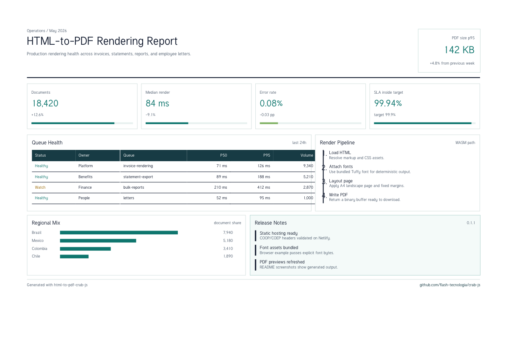
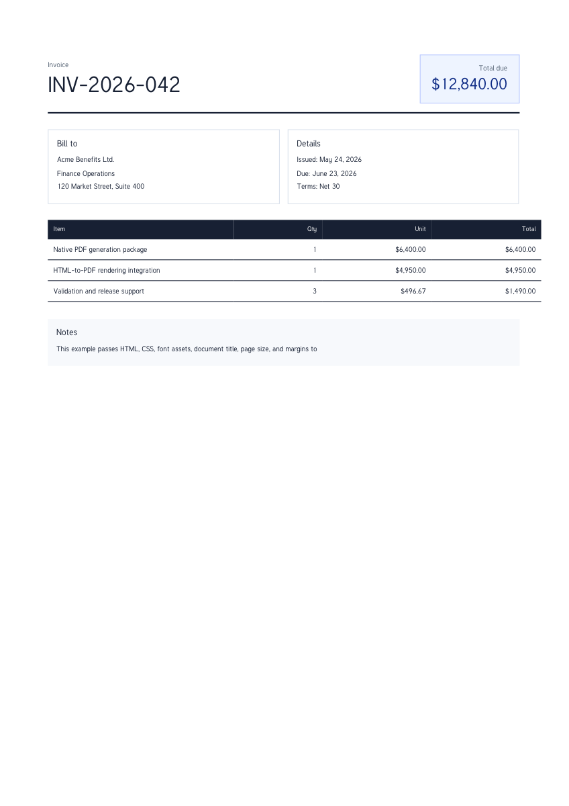

# html-to-pdf-crab-js

Chromium-free HTML-to-PDF rendering for Node.js and WebAssembly, built with Rust and NAPI-RS.

Try the interactive browser demo at [pdf-crab-js.netlify.app](https://pdf-crab-js.netlify.app/).

Use this package when the source document is already HTML and CSS: invoices, reports, printable
screens, exports, letters, and documents that benefit from normal web layout. If you need low-level,
coordinate-based PDF generation, use [`pdf-crab-js`](../pdf-crab-js/README.md).

`html-to-pdf-crab-js` is the easy HTML path in the Crab JS PDF stack. It converts HTML/CSS to PDF
without running Chromium, Puppeteer, Playwright, or a Gotenberg service. The rendering pipeline is
native Rust exposed through NAPI-RS, with a WASM build for browser and portable runtimes.

## Why html-to-pdf-crab-js

- Keep authoring documents in HTML and CSS instead of translating layouts into PDF coordinates.
- Avoid a heavyweight browser process or external conversion service for common document exports.
- Pass explicit CSS, fonts, images, page size, margins, and orientation through one small API.
- Use the same package family as `pdf-crab-js`: HTML/CSS for convenience, structured PDF for
  maximum speed.

## Benchmark Snapshot

Current local reference run from [`benchmarks/pdf/table.ts`](../../benchmarks/pdf/table.ts) on Node.js
24.19.0/Darwin arm64: 10 pages, 10 rows per page, 3 warmups, and 10 measured runs. Each row is a
separate workload; structured PDF and HTML/CSS conversion are not a global leaderboard.

| Workload               | Implementation          | Output   |        p50 |        p95 |  Throughput (p50) |
| ---------------------- | ----------------------- | -------- | ---------: | ---------: | ----------------: |
| Declarative/manual     | Node + pdf-crab         | Buffered |   5.733 ms |   8.363 ms | 1,744.402 pages/s |
| High-level table       | Node + pdf-crab         | Buffered |  10.491 ms |  11.625 ms |   953.202 pages/s |
| HTML/CSS conversion    | Node + html-to-pdf-crab | Buffered |  18.306 ms |  18.972 ms |   546.270 pages/s |
| Remote HTML conversion | Node + Gotenberg        | Buffered | 134.139 ms | 202.919 ms |    74.550 pages/s |

In the HTML/CSS workload, `html-to-pdf-crab-js` rendered 10 pages at 546.270 pages/s in this run,
while the remote Gotenberg scenario rendered 74.550 pages/s. `html-to-pdf-crab-js` keeps the
HTML/CSS workflow without a Chromium service; the structured PDF rows solve a different problem and
are included only as context. Benchmark results are workload and machine dependent.

## PDF Results

These previews are generated from `examples/html-to-pdf-crab-js/report.ts` and
`examples/html-to-pdf-crab-js/invoice.ts`.





## Install

```bash
npm install html-to-pdf-crab-js
```

Requirements:

- Node.js `24` for the native package.
- Browser WASM works without cross-origin isolation by default. The optional threaded entry point
  requires `SharedArrayBuffer` and COOP/COEP headers.

## Quick Start

```js
import { readFileSync, writeFileSync } from 'node:fs'
import { createPdfFromHtml } from 'html-to-pdf-crab-js'

const html = readFileSync('invoice.html', 'utf8')
const css = readFileSync('invoice.css', 'utf8')
const font = readFileSync('assets/Tuffy.ttf')

const pdf = await createPdfFromHtml({
  html,
  css,
  fonts: [font],
  basePath: process.cwd(),
  page: {
    size: 'A4',
    margin: { top: 14, right: 14, bottom: 16, left: 14, unit: 'mm' },
  },
  systemFonts: false,
  title: 'Invoice INV-2026-042',
})

writeFileSync('invoice.pdf', pdf)
```

## API

| Export                     | Description                           |
| -------------------------- | ------------------------------------- |
| `createPdfFromHtml(input)` | Renders HTML/CSS into a PDF `Buffer`. |

### `CreatePdfFromHtmlInput`

| Field         | Description                                                                                                   |
| ------------- | ------------------------------------------------------------------------------------------------------------- |
| `html`        | Required HTML document string. Must not be empty.                                                             |
| `title`       | Optional PDF title.                                                                                           |
| `lang`        | Optional document language as a BCP 47 tag, such as `pt-BR`.                                                  |
| `css`         | Optional CSS string or array of CSS strings.                                                                  |
| `basePath`    | Optional base path for resolving relative assets. Must not be empty when provided.                            |
| `systemFonts` | Enables host system fonts when `true`; defaults to `true`. Use `false` for deterministic bundled-font output. |
| `fonts`       | Optional array of font buffers in Node. Browser WASM examples normalize binary font assets to base64.         |
| `images`      | Optional named image assets. Names are referenced from HTML/CSS asset paths.                                  |
| `page`        | Optional page size, margins, and orientation.                                                                 |
| `bookmarks`   | Enables or disables generated bookmarks when supported by the renderer.                                       |
| `tagged`      | Enables or disables tagged PDF output when supported by the renderer.                                         |
| `pdfUa`       | Enables or disables PDF/UA mode. Requires a document language from `lang` or `<html lang="...">`.             |

### Document Language and PDF/UA

`lang` takes precedence over the HTML document's `<html lang="...">` attribute. If `lang` is omitted
or contains only whitespace, the renderer uses the HTML attribute instead. PDF/UA mode requires a
nonempty document language; other rendering modes allow it to be omitted.

```js
const pdf = await createPdfFromHtml({
  html: '<h1>Relatório</h1><p>Documento em português.</p>',
  lang: 'pt-BR',
  pdfUa: true,
  title: 'Relatório',
})
```

### Page Options

```ts
type HtmlPdfPageInput = {
  size?: 'A4' | 'LETTER' | 'A3' | { width: number; height: number; unit?: 'mm' | 'pt' }
  margin?: number | { top: number; right: number; bottom: number; left: number; unit?: 'mm' | 'pt' }
  landscape?: boolean
}
```

A numeric `margin` is interpreted as millimeters. Custom page sizes and margin objects support
`mm` and `pt`.

## Fonts and Assets

For reliable rendering, pass explicit fonts and set `systemFonts: false`:

```js
const font = readFileSync('assets/Tuffy.ttf')

await createPdfFromHtml({
  html,
  css,
  fonts: [font],
  systemFonts: false,
})
```

`basePath` is useful when the HTML references local assets with relative paths. For browser WASM,
see `examples/html-to-pdf-crab-js/wasm/browser.ts`; it fetches font bytes and converts them before
calling the WASI binding.

## Browser and WASM

Browser, Deno, Bun, and portable runtimes can use the threadless NAPI-RS WebAssembly build:

```js
import { createPdfFromHtml } from 'html-to-pdf-crab-js/browser'
```

The default browser build does not require `SharedArrayBuffer` or cross-origin isolation. An
optional threaded build is available for isolated deployments:

```js
import { createPdfFromHtml } from 'html-to-pdf-crab-js/browser/threaded'
```

The threaded entry point requires the normal cross-origin isolation headers:

```text
Cross-Origin-Embedder-Policy: require-corp
Cross-Origin-Opener-Policy: same-origin
```

The combined Netlify browser sample lives in `examples/wasm-samples/` and demonstrates both
packages using the threadless browser entries. Both browser entries expose the same API.

The root package carries the browser artifacts and their production runtime dependencies. The matching
WASI flavor packages install as optional dependencies on all supported host architectures, so the
generated Workerd entry point works with a normal install. Keep optional dependencies enabled. The
threadless WASI package can also be installed separately for direct access to the low-level binding:

```bash
npm install html-to-pdf-crab-js-wasm32-wasip1
```

Published sample: https://pdf-crab-js.netlify.app/#html-to-pdf-crab-js

## Examples

Run the Node examples from the workspace root:

```bash
pnpm --filter html-to-pdf-crab-js-examples invoice
pnpm --filter html-to-pdf-crab-js-examples report
```

Generated files are written to `examples/html-to-pdf-crab-js/output/`.

Run the browser WASM example:

```bash
pnpm --filter html-to-pdf-crab-js-examples browser
```

This command rebuilds the local WASI browser binding before starting Vite.

Open `/wasm/` on the local Vite server. The page previews `report.html` and renders that same
HTML/CSS into a PDF iframe.

Browser builds use the generated `*.wasip1-browser.js` loader. The package build rewrites that loader
to use async WASM instantiation because browser engines reject synchronous compilation for the
current WASM artifact size. Restart the Vite dev server after rebuilding the package so the page
loads the regenerated loader cleanly.

Preview the source HTML in a browser:

```bash
open examples/html-to-pdf-crab-js/invoice.html
open examples/html-to-pdf-crab-js/report.html
```

## Development

Install dependencies from the workspace root:

```bash
pnpm install --filter html-to-pdf-crab-js
```

Build and test:

```bash
pnpm --filter html-to-pdf-crab-js build
pnpm --filter html-to-pdf-crab-js test
pnpm --filter html-to-pdf-crab-js check
pnpm --filter html-to-pdf-crab-js lint
pnpm --filter html-to-pdf-crab-js fmt:check
```

Build and smoke-test the WebAssembly binding:

```bash
rustup target add wasm32-wasip1
pnpm --filter html-to-pdf-crab-js build:wasm
pnpm --filter html-to-pdf-crab-js test:wasm
```

Build and test the optional threaded target with `build:wasm-threaded` and
`test:wasm-threaded` when cross-origin isolation is available.

### Workerd

For Cloudflare Workers, workerd, or another host that supplies the WebAssembly module itself,
install the root package and use the generated deferred loader:

```bash
npm install html-to-pdf-crab-js
```

```js
import wasmModule from 'html-to-pdf-crab-js/wasm.wasm'
import { dispose, instantiate } from 'html-to-pdf-crab-js/workerd'

const binding = await instantiate(wasmModule)
const pdf = await binding.createPdfFromHtml({ html: '<h1>Hello</h1>' })
await dispose()
```

The Workerd loader is deferred and safe to initialize more than once; dispose instances when a
request or isolate is complete.

## Release

The root package is packed with `pnpm pack` and published with `pnpm publish`, which resolve workspace
catalog references to concrete versions. Native and WebAssembly platform packages are prepared and
published by `napi prepublish -t npm`; `-t npm` selects the Git tag format.
